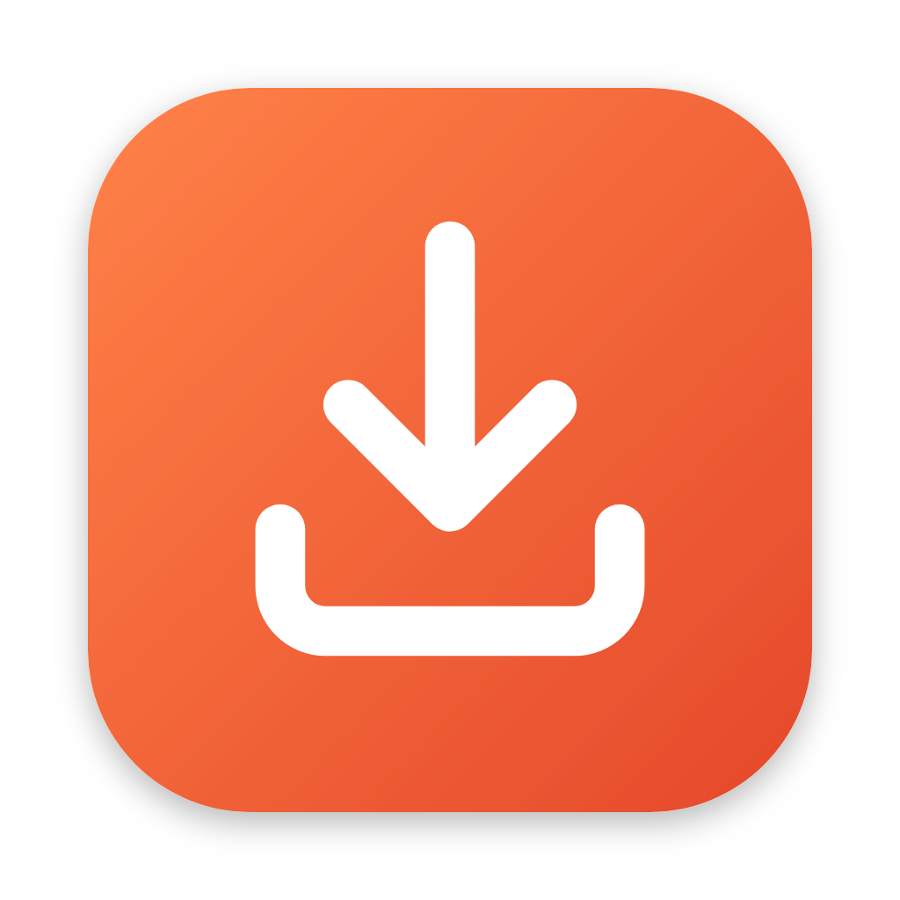
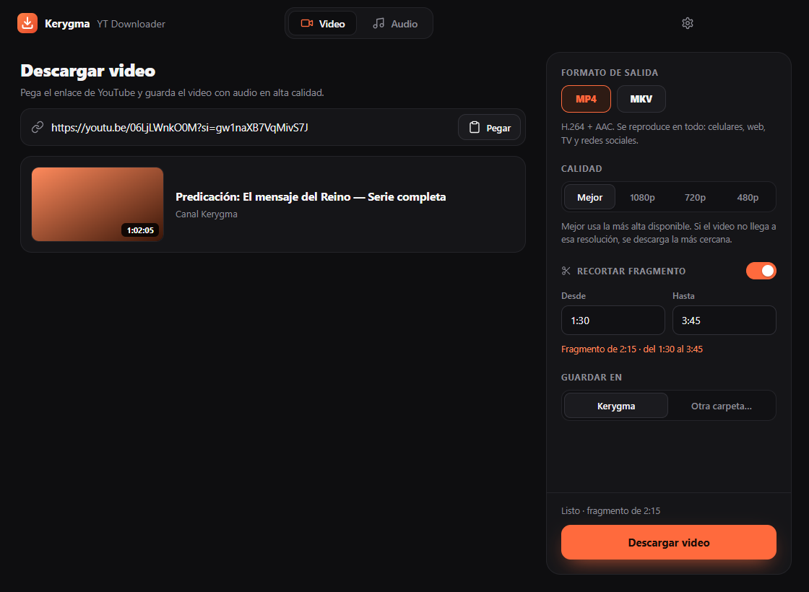
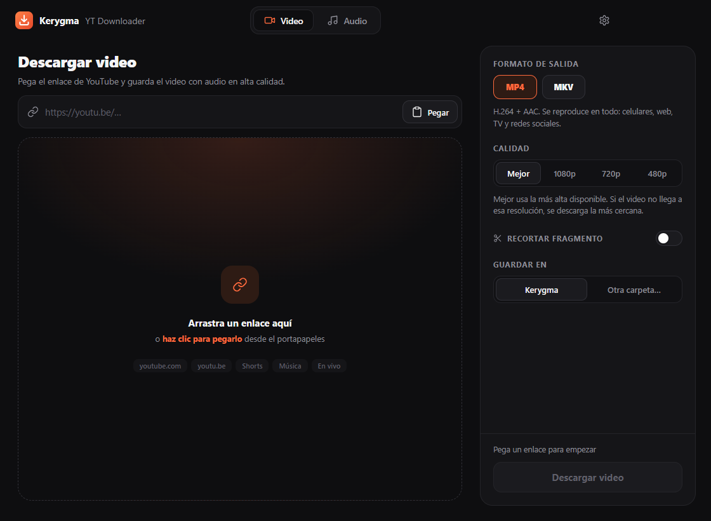
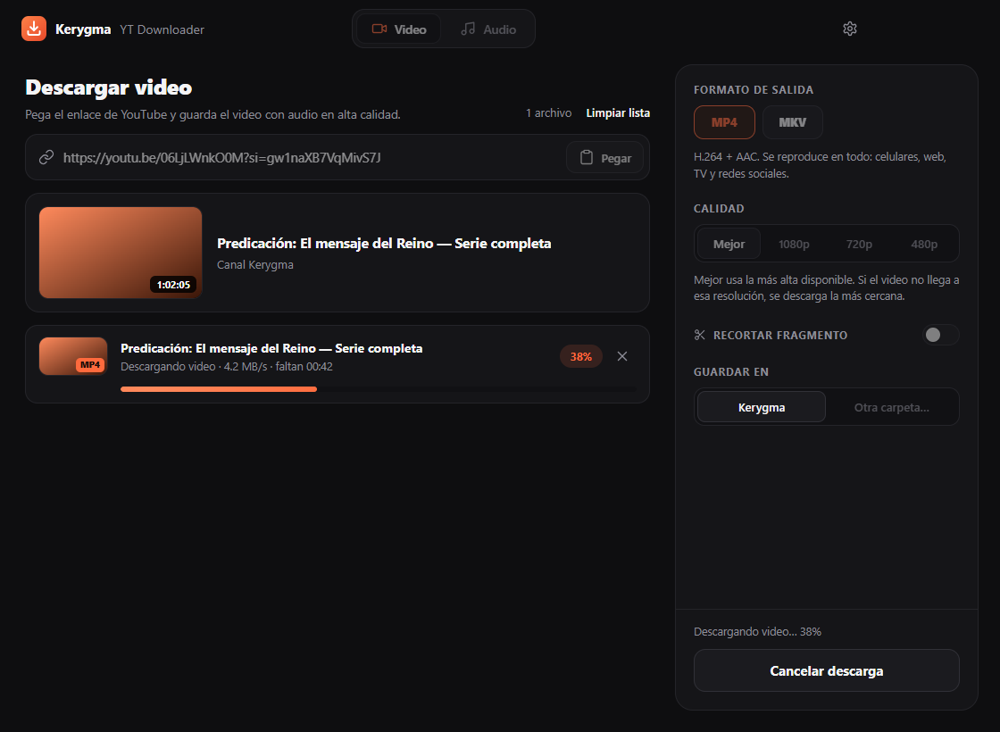
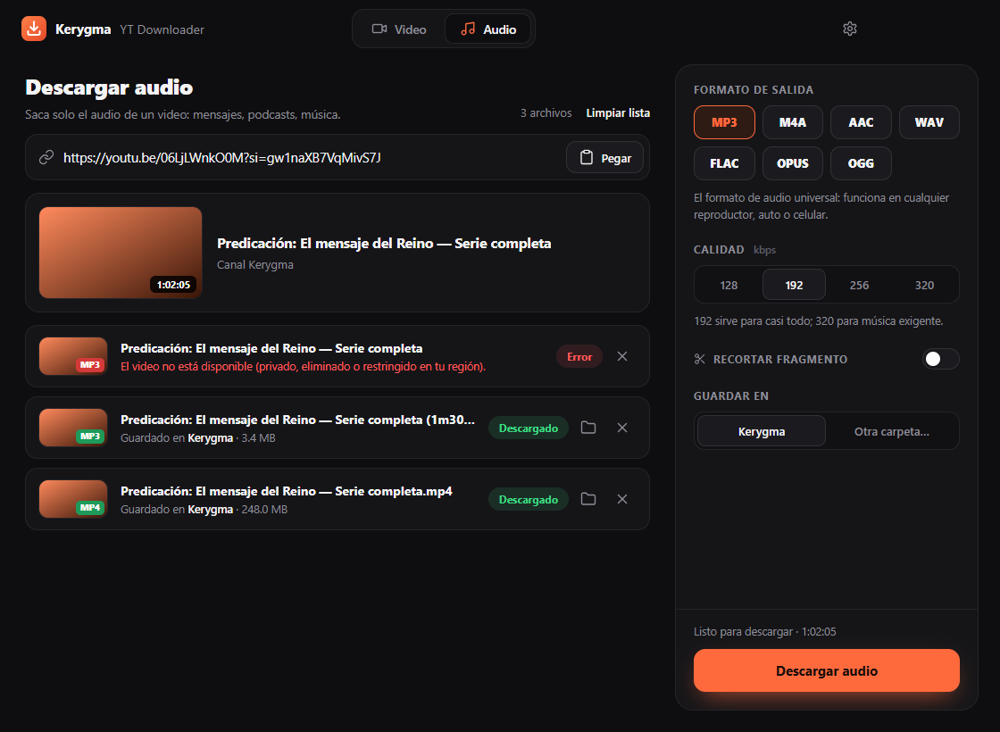
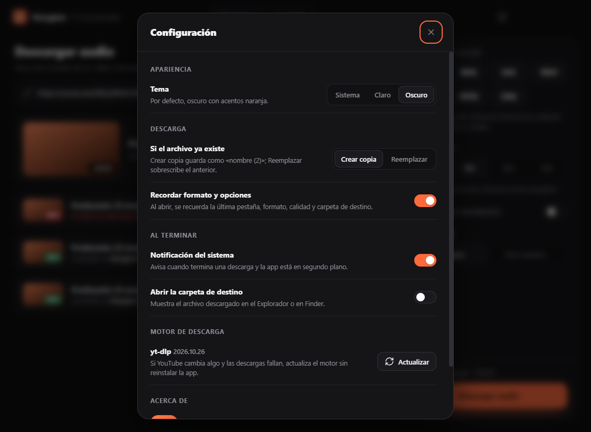
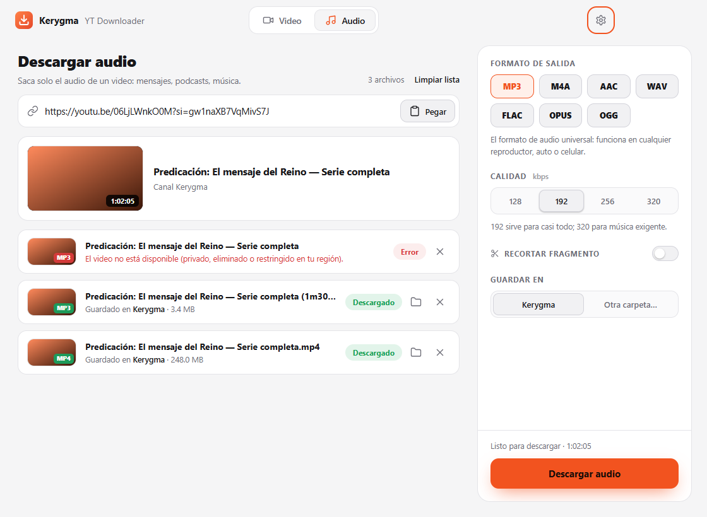
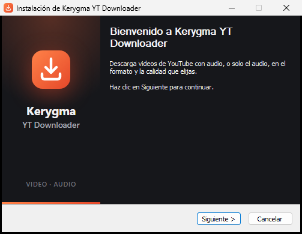
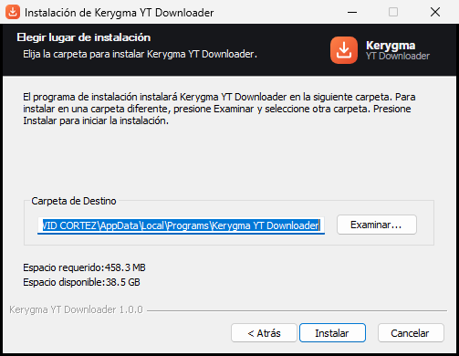

<p align="center">
  
</p>

<h1 align="center">Kerygma YT Downloader</h1>

<p align="center">
  Descarga videos de YouTube con audio, o solo el audio, en el formato y la calidad que elijas.<br>
  Para <b>Windows y macOS</b>, con yt-dlp y ffmpeg incluidos: no hay que instalar nada más.
</p>

<p align="center">
  <a href="https://github.com/DavidCortesA/keygma-yt-downloader/releases/latest"><b>Descargar la última versión</b></a>
  ·
  Hermano de <a href="https://github.com/DavidCortesA/converter-kerygma">Kerygma Converter</a>
</p>



> Descarga solo contenido que tengas derecho a descargar y respeta los Términos de Servicio de YouTube.

## Descargar la app

En la [página de Releases](https://github.com/DavidCortesA/keygma-yt-downloader/releases/latest), cada versión se descarga por separado:

| Archivo | Para quién |
|---|---|
| `Kerygma-YT-Downloader-<versión>-Windows-Instalador.exe` | Windows: se instala con acceso directo en el menú Inicio y desinstalador |
| `Kerygma-YT-Downloader-<versión>-Windows-Portable.exe` | Windows: se abre directo, sin instalar (ideal para una USB) |
| `Kerygma-YT-Downloader-<versión>-Mac-Apple-Silicon.dmg` | Mac con chip M1, M2, M3 o posterior |
| `Kerygma-YT-Downloader-<versión>-Mac-Intel.dmg` | Mac con procesador Intel |

La app no está firmada con certificados de pago:

- **Windows:** si SmartScreen muestra "Windows protegió su PC", haz clic en **Más información → Ejecutar de todas formas**.
- **macOS:** la primera vez, clic derecho sobre la app → **Abrir** → **Abrir** (o `xattr -cr "/Applications/Kerygma YT Downloader.app"` en la Terminal).

## Funciones

- **Pestaña Video:** MP4 (H.264 + AAC, compatible con todo) o MKV (lo mejor disponible, hasta 4K), con tope de calidad Mejor / 1080p / 720p / 480p.
- **Pestaña Audio:** MP3, M4A, AAC, WAV, FLAC, OPUS u OGG; calidad de 128 a 320 kbps en los formatos con compresión.
- **Recortar fragmento:** descarga solo de un minuto a otro (`mm:ss` o `h:mm:ss`), en video o audio, con cortes exactos.
- Pega el enlace, arrástralo a la ventana o usa el botón **Pegar**; vista previa con miniatura, título y duración.
- Lista de descargas con miniatura, progreso, velocidad y tiempo restante, cancelación limpia y acceso directo a la carpeta.
- **Configuración:** tema (sistema, claro u oscuro), crear copia o reemplazar si el archivo existe, recordar opciones, notificación del sistema al terminar, abrir la carpeta de destino y **actualizar el motor** (`yt-dlp`) cuando YouTube cambie algo.

## Capturas

| Inicio | Descargando |
|---|---|
|  |  |
| **Lista de descargas** | **Configuración** |
|  |  |

La app sigue el tema claro u oscuro del sistema, o el que elijas en Configuración:



### Instalador de Windows

En español y con los colores de la app, como el de Kerygma Converter. Crea la carpeta **Kerygma YT Downloader** en el menú Inicio, con la app y un acceso **Desinstalar Kerygma YT Downloader**. También se desinstala desde **Configuración → Aplicaciones**, y el desinstalador borra los datos de la app.

| Bienvenida | Carpeta de destino |
|---|---|
|  |  |

### Modo 100 % portable

Por defecto la configuración se guarda en la carpeta de datos del sistema. Para llevarla contigo (por ejemplo en una USB), crea una carpeta llamada `KerygmaData` junto a la app: si existe, ahí se guarda todo. Con el `.exe` portable de Windows esa carpeta se crea sola junto al ejecutable.

## Desarrollo

Requisitos: Node.js 20 o superior.

```bash
npm install
npm run fetch-bins   # descarga yt-dlp y ffmpeg de tu plataforma a ./bin (verifica el SHA-256 de yt-dlp)
npm start            # abre la app
npm test             # pruebas sin conexión (validaciones, configuración, opciones inválidas)
node scripts/smoke-test.js --online   # pruebas reales: formatos, copia/reemplazo, recortes y cancelación (tarda unos minutos)
npm run screenshot   # captura la interfaz con datos simulados (dist/screenshots)
npm run icon         # regenera el logo, los íconos y las imágenes del instalador
```

> Evita desarrollar dentro de carpetas sincronizadas con iCloud (Documentos o Escritorio en macOS): `codesign` y algunos binarios se comportan mal ahí.

## Publicar una versión

```bash
npm run dist:win   # instalador + portable de Windows (en Windows)
npm run dist:mac   # .dmg para Intel y Apple Silicon (en macOS)
```

La forma recomendada es **GitHub Actions** ([`.github/workflows/build.yml`](.github/workflows/build.yml)): compila en Windows y en los dos tipos de Mac, corre las pruebas y, al subir una etiqueta, crea la Release con los cuatro archivos:

```bash
git tag v1.0.0
git push origin v1.0.0
```

## Arquitectura

```
main.js                     Proceso principal: ventana, IPC, configuración, modo portable
preload.js                  Puente seguro (contextBridge) hacia la interfaz
src/core/
  binaries.js               Copia yt-dlp/ffmpeg a una caché local y devuelve sus rutas
  ytdlp.js                  Único módulo que conoce los flags de yt-dlp (info, formatos, calidad, recorte, progreso, update)
  settings.js               Esquema de la configuración: valores de fábrica, validación y regla de "recordar opciones"
  validate.js               Validación de enlaces y nombres de archivo válidos en Windows/macOS
src/renderer/               Interfaz (HTML + CSS + JS, sin frameworks, con CSP estricta)
build/                      Íconos, imágenes y personalización del instalador (installer.nsh)
scripts/                    fetch-binaries, smoke-test, make-icon, screenshot, after-pack
```

Decisiones clave:

- **yt-dlp y ffmpeg incluidos** en la app. Las librerías npm de YouTube se rompen seguido; `yt-dlp` se actualiza casi a diario y la app puede actualizarlo en el lugar.
- **El motor se ejecuta desde la caché local**, no desde donde esté la app (USB, Escritorio con iCloud, carpeta de solo lectura).
- **Recorte:** `--download-sections` con `--force-keyframes-at-cuts` en video **y audio** (sin él, el audio salía con segundos de más: 10 s en vez de 7 s); recodifica solo el tramo. El progreso se lee de la salida de ffmpeg, porque yt-dlp no lo informa en los recortes.
- **Seguridad:** `contextIsolation`, `sandbox`, sin `nodeIntegration`, navegación externa bloqueada y validación de todo lo que llega por IPC.

## Licencia

MIT. `yt-dlp` (Unlicense) y `ffmpeg` (LGPL/GPL) se distribuyen con sus propias licencias.
