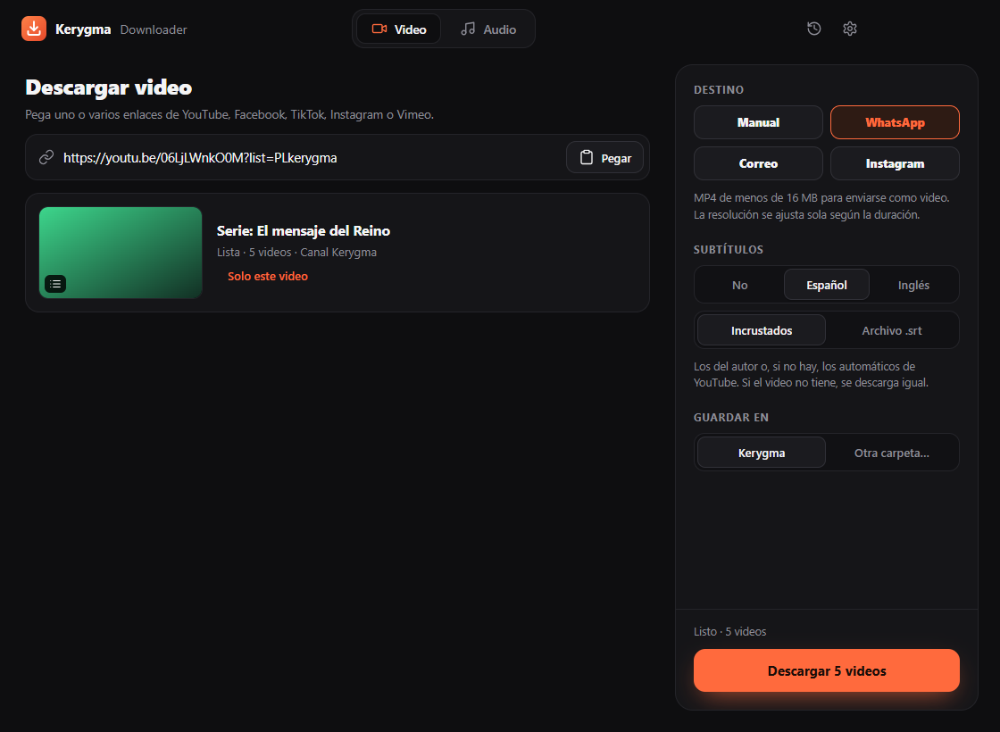
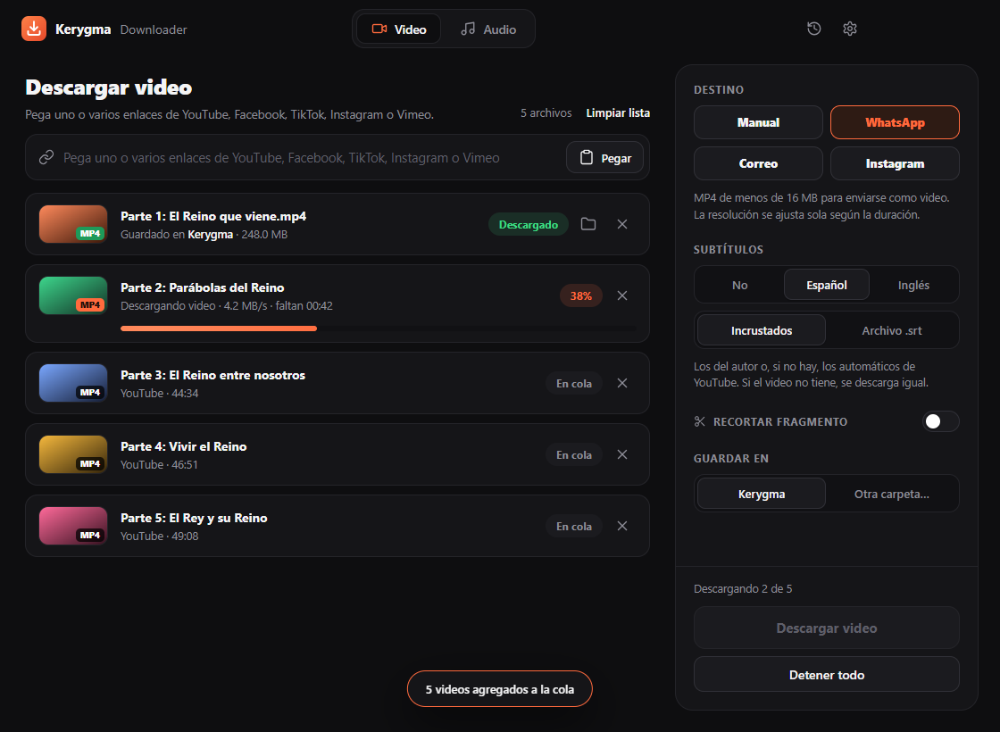
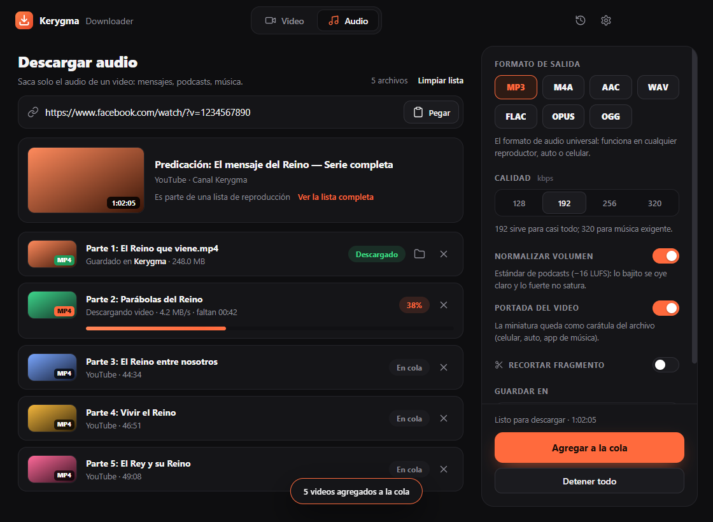
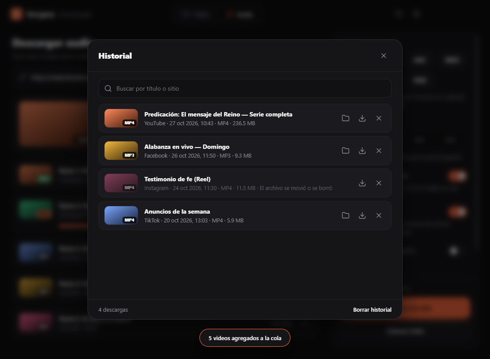
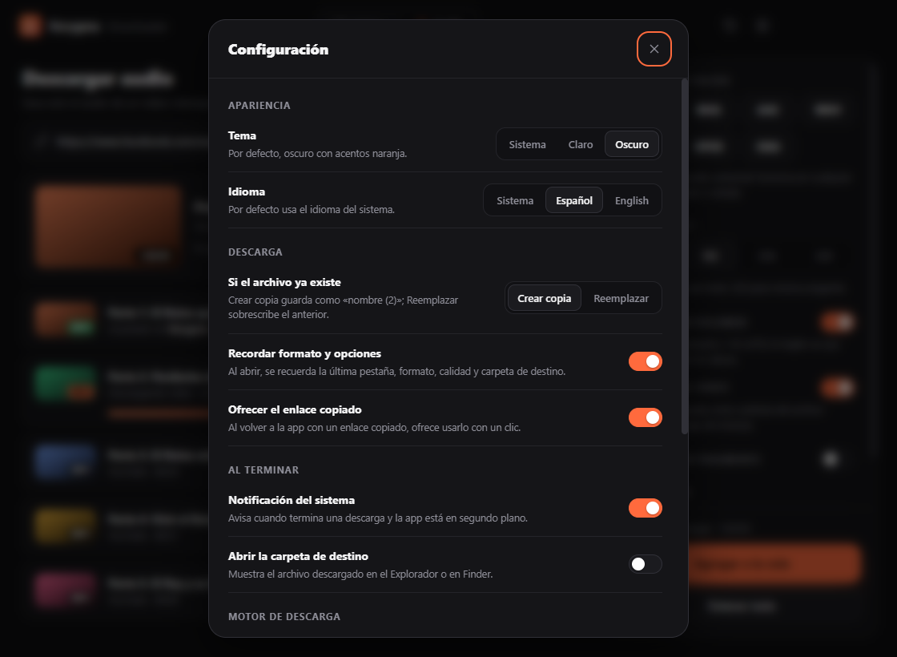
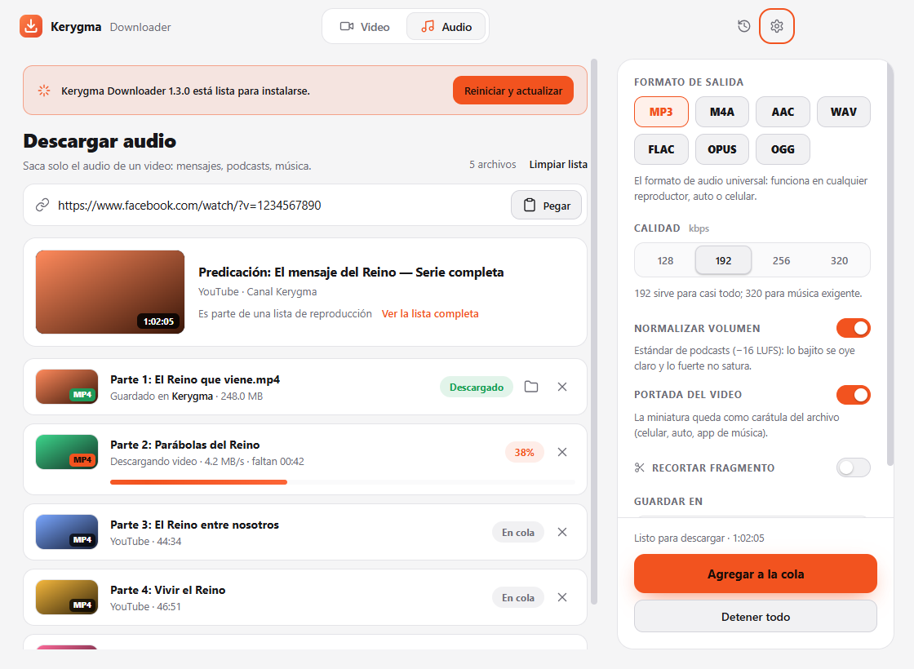
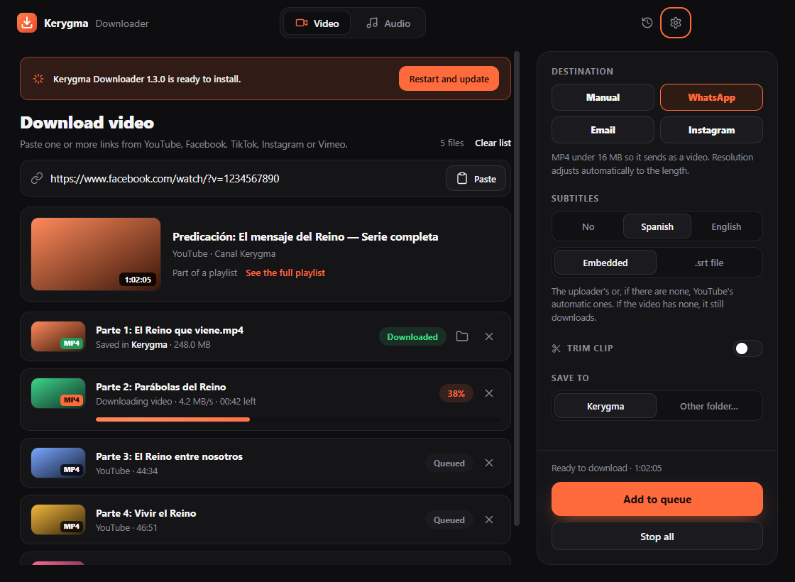

<p align="center">
  
</p>

<h1 align="center">Kerygma Downloader</h1>

<p align="center">
  Descarga videos de <b>YouTube, Facebook, TikTok, Instagram y Vimeo</b> con audio, o solo el audio,<br>
  en el formato y la calidad que elijas. Para <b>Windows y macOS</b>, con yt-dlp y ffmpeg incluidos.
</p>

<p align="center">
  <a href="https://github.com/DavidCortesA/keygma-yt-downloader/releases/latest"><b>Descargar la última versión</b></a>
  ·
  Hermano de <a href="https://github.com/DavidCortesA/converter-kerygma">Kerygma Converter</a>
</p>



> Descarga solo contenido que tengas derecho a descargar y respeta los Términos de Servicio de cada sitio.

## Sitios admitidos

| Sitio | Enlaces que acepta |
|---|---|
| **YouTube** | Videos, Shorts, en vivo y YouTube Music (`youtube.com/watch`, `youtu.be`, `/shorts/`, `/live/`), **listas de reproducción** (`/playlist?list=…`) y **canales** (`/@canal`, `/channel/…`) |
| **Facebook** | Videos, Reels y enlaces compartidos (`facebook.com/watch`, `/reel/`, `/videos/`, `/share/v/`, `fb.watch`) |
| **TikTok** | Videos y enlaces cortos de la app (`tiktok.com/@usuario/video/…`, `vm.tiktok.com`, `vt.tiktok.com`) |
| **Instagram** | Publicaciones, Reels e IGTV (`instagram.com/p/`, `/reel/`, `/tv/`) |
| **Vimeo** | Videos, canales, showcases y el reproductor embebido (`vimeo.com/123…`, `player.vimeo.com/video/…`) |

Se descargan los videos **públicos**. Los privados o con acceso restringido (por ejemplo, de grupos de Facebook o cuentas privadas de Instagram) piden iniciar sesión, y la app lo avisa con un mensaje claro. En TikTok, el video normalmente sale sin marca de agua, aunque depende de cómo lo entregue el sitio.

## Descargar la app

En la [página de Releases](https://github.com/DavidCortesA/keygma-yt-downloader/releases/latest), cada versión se descarga por separado:

| Archivo | Para quién |
|---|---|
| `Kerygma-Downloader-<versión>-Windows-Instalador.exe` | Windows: se instala con acceso directo en el menú Inicio y desinstalador |
| `Kerygma-Downloader-<versión>-Windows-Portable.exe` | Windows: se abre directo, sin instalar (ideal para una USB) |
| `Kerygma-Downloader-<versión>-Mac-Apple-Silicon.dmg` | Mac con chip M1, M2, M3 o posterior |
| `Kerygma-Downloader-<versión>-Mac-Intel.dmg` | Mac con procesador Intel |

La app no está firmada con certificados de pago:

- **Windows:** si SmartScreen muestra "Windows protegió su PC", haz clic en **Más información → Ejecutar de todas formas**.
- **macOS:** la primera vez, clic derecho sobre la app → **Abrir** → **Abrir** (o `xattr -cr "/Applications/Kerygma Downloader.app"` en la Terminal).

Hasta la versión 1.0 la app se llamaba **Kerygma YT Downloader**. Al actualizar, el instalador reemplaza la versión anterior y la app conserva tu configuración.

### Actualizaciones

- **Windows instalado:** desde la 1.2.0 la app baja sola la versión nueva en segundo plano y muestra **Reiniciar y actualizar**.
- **Mac y Windows portable:** la app avisa cuando hay una versión nueva, con un botón a la página de descarga.
- **El motor (`yt-dlp`)** se actualiza solo, como máximo una vez al día y nunca a mitad de una descarga. Así los sitios siguen funcionando aunque cambien algo.

Las tres cosas se pueden apagar en Configuración.

## Funciones

- **Varios enlaces a la vez:** pega uno o varios (uno por línea o separados por espacios) y se descargan en **cola**, uno tras otro, con miniatura, progreso, velocidad y tiempo restante. Puedes quitar uno de la cola o **Detener todo**.
- **Listas de reproducción y canales de YouTube:** se ve cuántos videos tiene y se descargan todos en cola. Si pegas un video que es parte de una lista, puedes elegir entre ese video o la lista completa.
- **Pestaña Video:** MP4 (H.264 + AAC, compatible con todo) o MKV (lo mejor disponible, hasta 4K), con tope de calidad Mejor / 1080p / 720p / 480p.
- **Destino:** **WhatsApp** (MP4 de menos de 16 MB, que se envía como video), **Correo** (menos de 20 MB) o **Instagram** (1080p con los ajustes que Instagram recomienda). La resolución baja sola según la duración del video, y si es demasiado largo para caber, la app lo dice antes de descargar.
- **Subtítulos** en español o inglés: los del autor o, si no hay, los automáticos de YouTube; incrustados en el video o como archivo `.srt`.
- **Pestaña Audio:** MP3, M4A, AAC, WAV, FLAC, OPUS u OGG; calidad de 128 a 320 kbps en los formatos con compresión.
  - **Normalizar volumen** a −16 LUFS (el estándar de los podcasts): lo bajito se oye claro y lo fuerte no satura.
  - **Portada del video** como carátula, más título y autor en los datos del archivo.
- **Recortar fragmento:** descarga solo de un minuto a otro (`mm:ss` o `h:mm:ss`), en video o audio, con cortes exactos.
- **Enlace copiado:** al volver a la app con un enlace en el portapapeles, ofrece usarlo con un clic.
- **Historial** de descargas guardado: búsqueda por título o sitio, abrir la carpeta, volver a descargar y borrar.
- **Español e inglés:** sigue el idioma del sistema o el que elijas.
- **Configuración:** tema (sistema, claro u oscuro), idioma, crear copia o reemplazar si el archivo existe, recordar opciones, notificación del sistema al terminar, abrir la carpeta de destino y actualizaciones de la app y del motor.

## Capturas

| Inicio, con un enlace copiado | Recorte y subtítulos |
|---|---|
|  |  |
| **Cola de descargas** | **Audio normalizado con portada** |
|  |  |
| **Historial** | **Configuración** |
|  |  |
| **Tema claro, con una actualización lista** | **En inglés** |
|  |  |

### Instalador de Windows

En español y con los colores de la app, como el de Kerygma Converter. Crea la carpeta **Kerygma Downloader** en el menú Inicio, con la app y un acceso **Desinstalar Kerygma Downloader**. También se desinstala desde **Configuración → Aplicaciones**, y el desinstalador borra los datos de la app.

| Bienvenida | Carpeta de destino |
|---|---|
|  |  |

### Modo 100 % portable

Por defecto la configuración y el historial se guardan en la carpeta de datos del sistema. Para llevarlos contigo (por ejemplo en una USB), crea una carpeta llamada `KerygmaData` junto a la app: si existe, ahí se guarda todo. Con el `.exe` portable de Windows esa carpeta se crea sola junto al ejecutable.

## Desarrollo

Requisitos: Node.js 20 o superior.

```bash
npm install
npm run fetch-bins   # descarga yt-dlp y ffmpeg de tu plataforma a ./bin (verifica el SHA-256 de yt-dlp)
npm start            # abre la app
npm test             # pruebas sin conexión: enlaces, listas, configuración, argumentos, destinos, historial, textos y ffmpeg real
node scripts/smoke-test.js --online   # pruebas reales: formatos, copia/reemplazo, recortes y cancelación (tarda unos minutos)
npm run screenshot   # captura la interfaz con datos simulados (dist/screenshots)
npm run icon         # regenera el logo, los íconos y las imágenes del instalador
```

> Evita desarrollar dentro de carpetas sincronizadas con iCloud (Documentos o Escritorio en macOS): `codesign` y algunos binarios se comportan mal ahí.

Para admitir otro sitio que yt-dlp ya soporte, basta con agregarlo a `PLATFORMS` en `src/core/validate.js` (y al filtro rápido `looksSupported` de `src/renderer/renderer.js`). Los textos de la interfaz están en `src/renderer/i18n.js`; `npm test` comprueba que español e inglés tengan las mismas claves.

## Publicar una versión

```bash
npm run dist:win   # instalador + portable de Windows (en Windows)
npm run dist:mac   # .dmg para Intel y Apple Silicon (en macOS)
```

La forma recomendada es **GitHub Actions** ([`.github/workflows/build.yml`](.github/workflows/build.yml)): compila en Windows y en los dos tipos de Mac, corre las pruebas y, al subir una etiqueta, crea la Release con los cuatro archivos y `latest.yml` (lo que lee la app instalada para actualizarse):

```bash
git tag v1.2.0
git push origin v1.2.0
```

## Arquitectura

```
main.js                     Proceso principal: ventana, IPC, configuración, historial, actualizaciones, modo portable
preload.js                  Puente seguro (contextBridge) hacia la interfaz
src/core/
  binaries.js               Copia yt-dlp/ffmpeg a una caché local y devuelve sus rutas
  ytdlp.js                  Único módulo que conoce los flags de yt-dlp (info, listas, formatos, subtítulos, recorte, progreso, update)
  postprocess.js            ffmpeg después de descargar: normalizar volumen y ajustar a un destino (WhatsApp, correo, Instagram)
  settings.js               Esquema de la configuración: valores de fábrica, validación y regla de "recordar opciones"
  history.js                Historial de descargas (JSON en la carpeta de datos, máximo 300)
  updates.js                Busca la versión más nueva en GitHub Releases (Mac y portable)
  errors.js                 Errores con código, que la interfaz traduce al idioma elegido
  validate.js               Sitios admitidos, listas y canales, validación de enlaces y nombres de archivo válidos
src/renderer/               Interfaz (HTML + CSS + JS, sin frameworks, con CSP estricta) y textos en español e inglés
build/                      Íconos, imágenes y personalización del instalador (installer.nsh)
scripts/                    fetch-binaries, smoke-test, make-icon, screenshot, after-pack
```

Decisiones clave:

- **yt-dlp y ffmpeg incluidos** en la app. Las librerías npm para descargar de cada sitio se rompen seguido; `yt-dlp` se actualiza casi a diario, admite cientos de sitios y la app lo mantiene al día sola.
- **MP4 siempre en H.264 + AAC:** se le pide a yt-dlp que prefiera esos códecs; sin eso, YouTube puede entregar AV1 y TikTok HEVC, que no abren en todos los equipos.
- **El motor se ejecuta desde la caché local**, no desde donde esté la app (USB, Escritorio con iCloud, carpeta de solo lectura).
- **Recorte:** `--download-sections` con `--force-keyframes-at-cuts` en video **y audio** (sin él, el audio salía con segundos de más: 10 s en vez de 7 s); recodifica solo el tramo. El progreso se lee de la salida de ffmpeg, porque yt-dlp no lo informa en los recortes.
- **Destinos:** se calcula el bitrate con la duración real y el límite de tamaño, con un tope de calidad para que un video corto no pese de más; si aun así se pasa, se recodifica con un 15 % menos. Se trabaja sobre un archivo temporal, así que cancelar nunca deja un archivo a medias.
- **Normalizar:** `loudnorm` de ffmpeg a −16 LUFS, conservando la portada y los datos del archivo.
- **Seguridad:** `contextIsolation`, `sandbox`, sin `nodeIntegration`, navegación externa bloqueada y validación de todo lo que llega por IPC.

## Licencia

MIT. `yt-dlp` (Unlicense) y `ffmpeg` (LGPL/GPL) se distribuyen con sus propias licencias.
